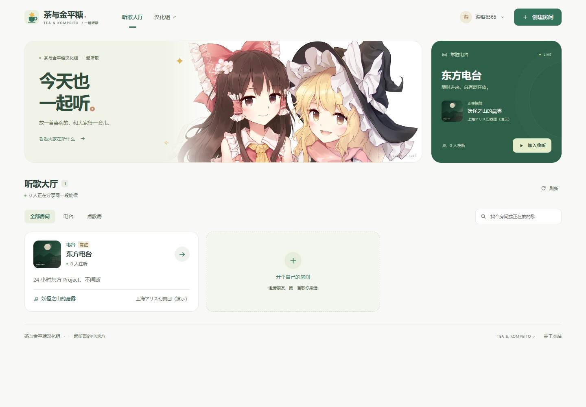
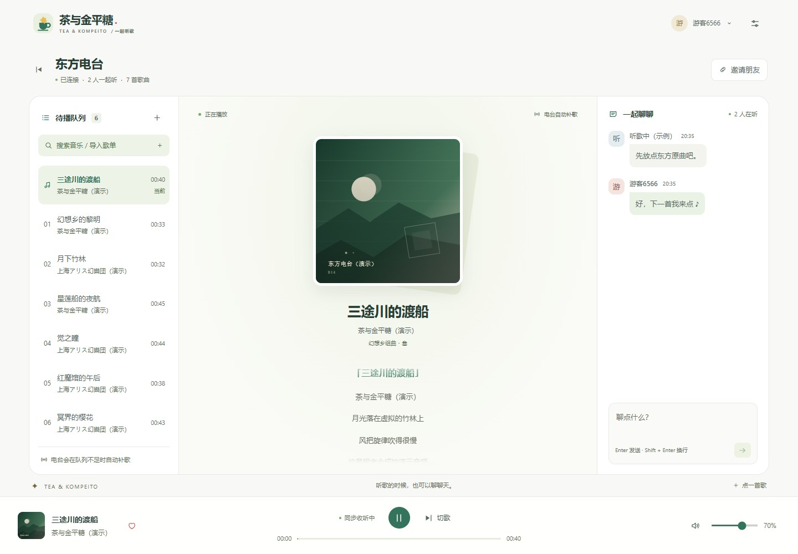
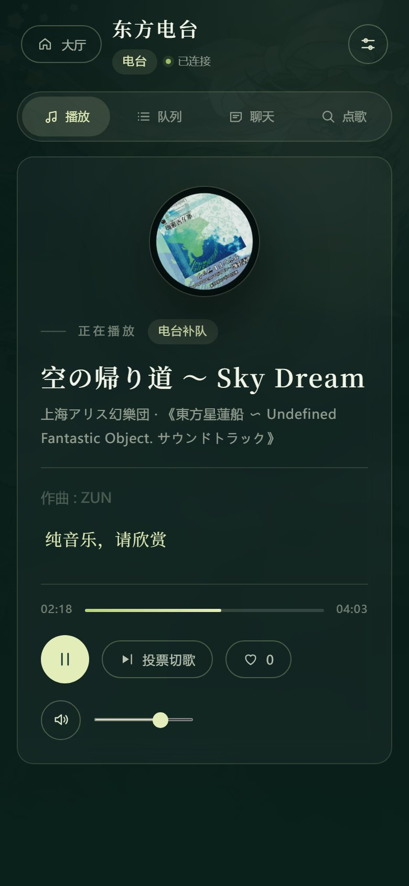

# 茶与金平糖 · 一起听

茶与金平糖汉化组的同步听歌网站，部署域名为 <https://music.tea-kompeito.com>。

前端使用 Vue 3、TypeScript 与 Vite，后端保留现有 Go 重写版，通过 HTTP 与原生 WebSocket 提供同步播放、点歌、歌单、电台和聊天。构建后前端内嵌进 Go 单二进制。

截图使用 demo 音源与示例聊天，展示实际页面布局。



| 听歌房 | 手机 |
| --- | --- |
|  |  |

下一首会提前取址并在浏览器后台缓冲，切歌优先复用已准备的播放器；歌词异步加载。初次加载 5 秒无媒体数据或播放中 12 秒无进度时，自动重新取址并支持降至 128k（最多恢复两次），手动暂停不会触发恢复。真实网络与生产效果仍需结合运行日志验证。

播放缓冲、直连音源与 1 Mbps 部署建议见 [排查与修复说明](docs/playback-buffering.md)。

## 界面与功能

- 大厅第一屏直接展示常驻电台；房间可按类型筛选、按名称或当前歌曲搜索。
- 灵梦与魔理沙双人主视觉，暖白与茶绿界面，图片来源可在关于弹窗和素材清单中查看。
- 桌面同时显示队列、封面与歌词、聊天；底部持续显示播放控制。手机切换面板时保持收听。
- 搜索点歌、按歌单关键词 / ID / 分享链接找歌、按用户昵称打开公开歌单逐首点播；点歌成功与失败均有弹窗内可见提示。
- 批量点歌、电台预设、投票切歌、待播歌曲投票删除、点赞、音量和管理员设置。
- 创建者自动获得本房房主权限，可自行设置或修改房间管理密码；服务器口令可管理全部房间和电台。
- 昵称跨房间保存，密码房创建后直接加入，分享地址不包含密码。
- 手机系统媒体控制（播放 / 暂停 / 投票切歌），后台播放与前台连接恢复；支持范围和真机验收见 [手机后台播放](docs/mobile-background.md)。
- 弹窗使用原生 dialog，支持 Escape、焦点约束与关闭后返回原按钮；适配减少动态效果偏好。

## 快速开始（本地，无需 cookie）

依赖：**Go 1.25+**、**Node 20+**。

```bash
# 1. 构建前端并拷进 Go embed 目录
npm --prefix web install
npm --prefix web run build
node scripts/copy-dist.mjs

# 2. 编译单二进制
go build -o bin/musicd ./server/cmd/musicd

# 3. 跑起来
./bin/musicd            # Windows PowerShell： .\bin\musicd.exe
```

打开 <http://127.0.0.1:8080>。

没有网易云 cookie 时自动使用 **demo provider**：24 首演示曲目 + 程序合成的音频，
界面、播放、同步、点歌、聊天全部可以完整体验。Windows 也可以直接 `.\build.ps1`，
Linux/macOS 用 `make build`。

### 开发模式

```bash
# 后端
go run ./server/cmd/musicd            # :8080

# 前端（Vite HMR，/api 自动反代到 :8080）
npm --prefix web run dev              # :5173

# 只想看 UI：不进后端，用内置 mock 数据
VITE_MOCK=1 npm --prefix web run dev
```

---

## 接真实的网易云

在仓库根目录创建 `server/config.local.json`（**已在 .gitignore 中，不会入库**）：

```json
{
  "neteaseCookie": "MUSIC_U=...; __csrf=...",
  "provider": "auto"
}
```

Cookie 获取：浏览器登录 <https://music.163.com> → DevTools → Application → Cookies →
`https://music.163.com` → 复制 `MUSIC_U`（以及 `__csrf` 如果有）。
`provider: "auto"` 时有 cookie 就用网易云（`wy`），没有就用 demo。
VIP 账号才能拿到 320k 地址；普通账号/无版权曲目会在播放时被跳过并提示。

也可以全部用环境变量覆盖：`MUSIC_HTTP_ADDR`、`MUSIC_NETEASE_COOKIE`、`MUSIC_PROVIDER`、
`MUSIC_DATA_DIR`、`MUSIC_ROOT_PASSWORD`、`MUSIC_ADMIN_PASSWORD`、`MUSIC_LOG_LEVEL`、`MUSIC_CONFIG`。

> 示例配置里的默认口令（`654321` / `123456`）部署前务必改掉。

---

## 部署（无 Docker）

```bash
# 1. 构建（本机交叉编译到 Linux）
make build                       # 产物 bin/musicd
#   或：GOOS=linux GOARCH=amd64 make build

# 2. 服务器上
useradd -r -s /usr/sbin/nologin -d /var/lib/musicd musicd
install -m 0755 bin/musicd /usr/local/bin/musicd
install -d -o musicd -g musicd /var/lib/musicd /etc/musicd
install -m 0600 server/config.local.json /etc/musicd/config.json
install -m 0644 deploy/musicd.service /etc/systemd/system/musicd.service
systemctl daemon-reload && systemctl enable --now musicd

# 3. nginx（关键：WebSocket 的 Upgrade 头 + 长 read_timeout）
cp deploy/nginx.conf.example /etc/nginx/conf.d/music.conf
# 改 server_name / 证书路径后：
nginx -t && systemctl reload nginx
```

更新版本：替换 `/usr/local/bin/musicd` 后 `systemctl restart musicd`。
**前端已经 embed 进二进制**，不需要单独发静态文件。

---

## 架构

```
浏览器（Vue 3 SPA）
   │  HTTP /api/*            房间列表、开房、配置
   │  WebSocket /api/ws      进入房间后的全部实时状态
   ▼
musicd（Go 单二进制，内嵌 web/dist）
   ├─ hub        房间表、队列状态机、服务器时钟推进、投票/点赞、权限、电台 DJ
   ├─ httpapi    REST + WS 升级 + 静态资源（SPA fallback）
   └─ provider   wy = 网易云 weapi（纯标准库加密）/ demo = 内置演示曲目与合成音频
```

完整协议（HTTP 接口、WS 消息、数据模型、配置字段、验收清单）见
[`docs/architecture.md`](docs/architecture.md)。

---

## 目录

```
web/                    Vue 3 + TS + Vite 前端（唯一前端真源）
  src/styles/tokens.css 设计变量（暖白、茶绿与少量红金色）
  src/views/            大厅与房间
  src/components/room/  播放器、歌词、队列、聊天、点歌面板、设置
server/                 Go 后端
  cmd/musicd/           入口
  internal/hub/         房间与 WS 协议
  internal/provider/    wy（网易云）与 demo
  internal/webui/       前端 embed 产物（构建时拷入）
docs/architecture.md    架构契约
deploy/                 systemd unit / nginx 示例
scripts/copy-dist.mjs   构建步骤：web/dist → server/internal/webui/dist
Makefile / build.ps1    构建入口
ui/ plus/ bot/          旧版实现（已停用，仅作参考）
```

### 测试

浏览器测试使用隔离的 demo 后端（18086 端口）和 Vite（5177 端口），覆盖密码房、双客户端同步与聊天、投票切歌、手机切换面板、管理员操作及错误状态。Windows 默认使用已安装的 Edge；其他平台首次运行前执行 `npx --prefix web playwright install chromium`。也可通过 `PLAYWRIGHT_CHROMIUM_EXECUTABLE_PATH` 指定浏览器。

```bash
go test ./server/...           # 后端单测（含网易云在线测试，无网络会 skip）
npm --prefix web run typecheck # 前端类型检查
npm --prefix web run build     # 前端生产构建
node scripts/copy-dist.mjs     # 为 Go embed 准备资源
npm --prefix web run test:e2e  # 浏览器集成测试
```

---

## 旧版说明

仓库里的 `ui/`、`plus/`、`bot/` 是上一代实现：官方 Vue2 界面 + 运行时注入脚本 + Java jar + Docker。
这些目录保留用于比较和迁移参考；当前部署入口为 `web/` 和 `server/`。

---

## 致谢与声明

- 主视觉为 **minusT《天空璋レイマリ》**，Pixiv 作品 [65515001](https://www.pixiv.net/artworks/65515001)，来自用户提供的图片包。仅压缩与格式转换，版权归原作者；完整记录见 `web/public/art/credits.json`。素材来源记录不代表额外授权。
- 东方 Project 二次创作，非官方粉丝站点。
- 歌曲、封面与歌词归各自权利人。网易云播放地址使用部署方账号凭据获取。
- demo provider 的曲名、歌词、几何封面和合成音频仅用于联调，不代表原曲内容。
